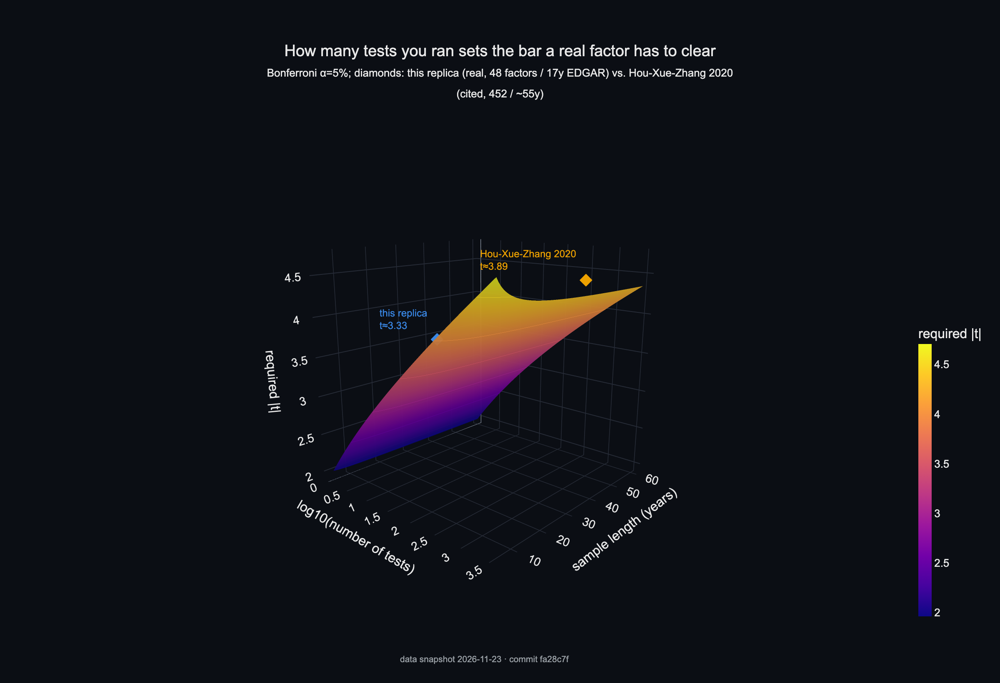
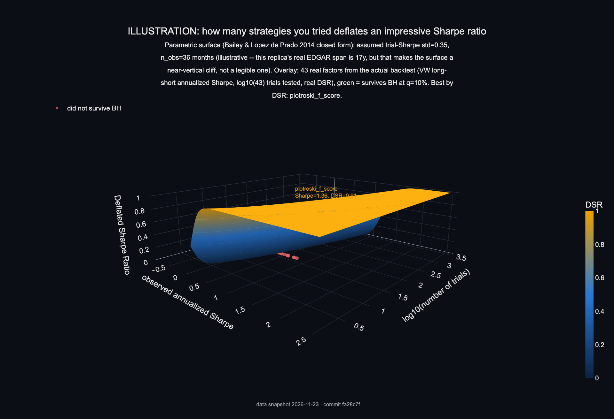
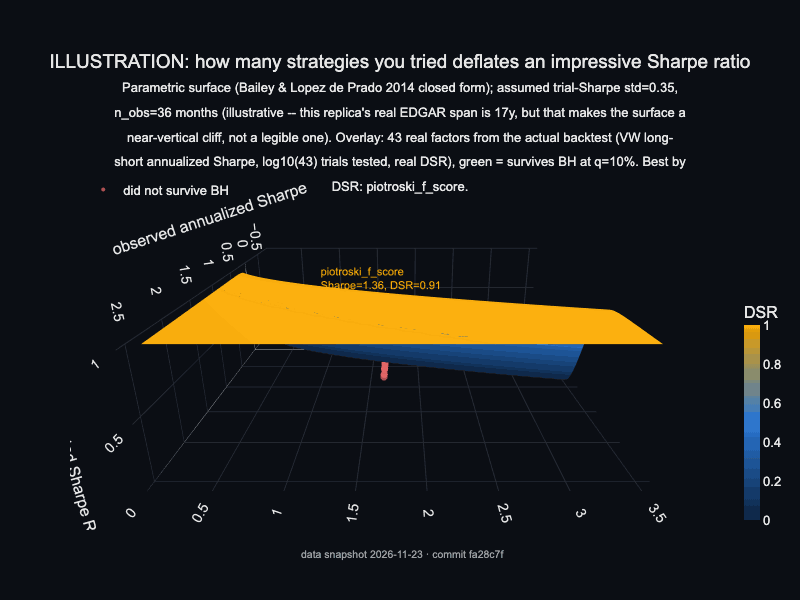
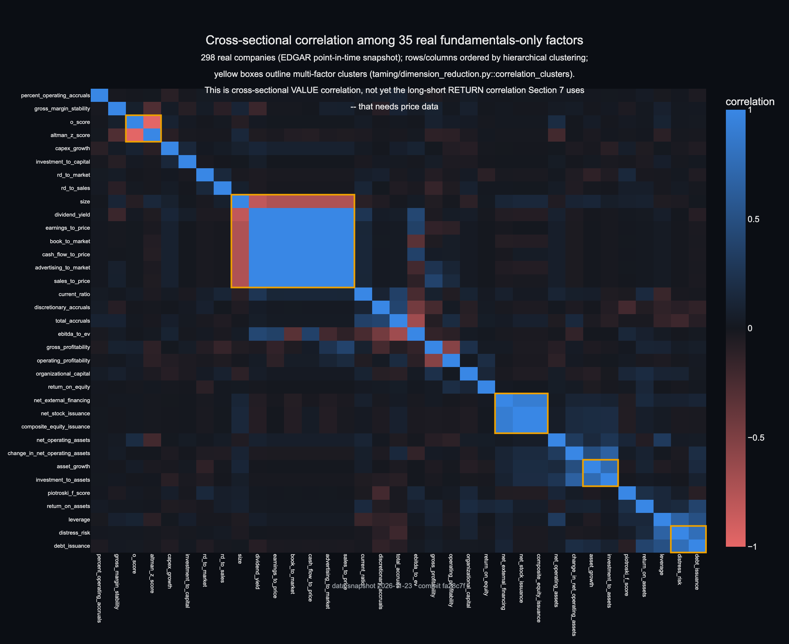
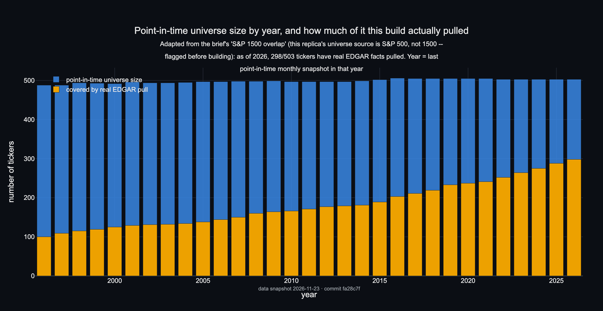
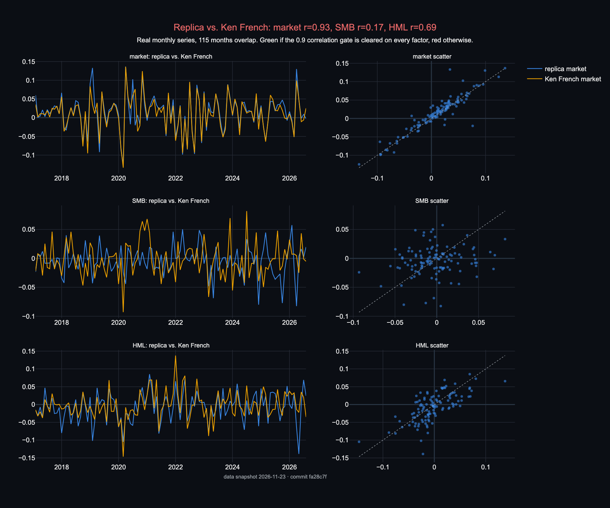
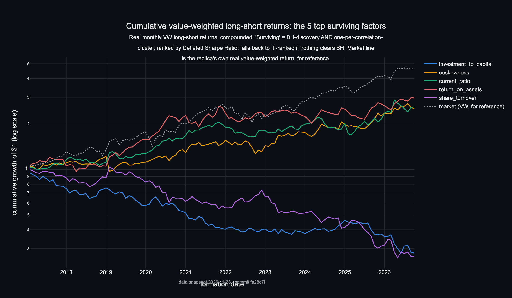
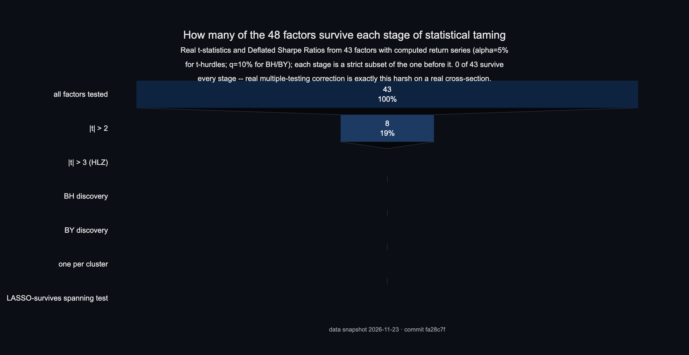
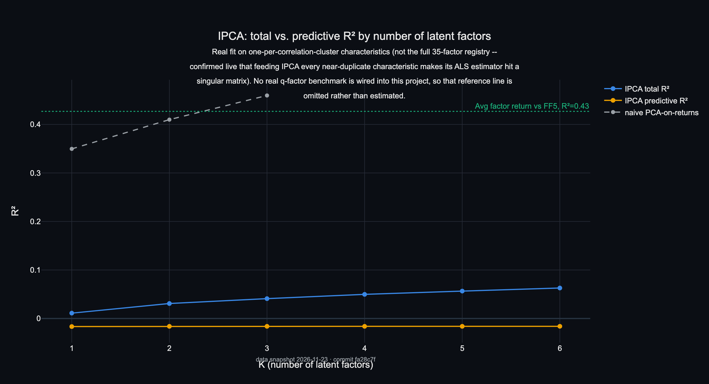

# Factor Zoo Replica

[](https://github.com/MithranHarsha/Factor-Zoo-Replica/actions/workflows/ci.yml)
[](https://github.com/MithranHarsha/Factor-Zoo-Replica/actions/workflows/leakage-tests.yml)
[](LICENSE)

A free-data, point-in-time-correct replication of the academic cross-sectional
factor zoo, with statistical taming (multiple-testing correction + dimension
reduction).

No WRDS/CRSP/Compustat subscription. Data sources: SEC EDGAR (fundamentals),
Yahoo Finance + Tiingo (prices), Ken French Data Library (benchmarks), and a
historical S&P 500 membership dataset (universe).

## Status

252 offline tests, all passing in CI.

- **Data.** EDGAR client, point-in-time DuckDB store, universe construction,
  Ken French loader, price clients. Pulled: 1,209 historical tickers, 850,304
  XBRL facts for 298 companies, 279 of them with daily price history
  (Tiingo), 15,897 days of FF5 factors.
- **Factor library.** All 48 factors compute against the real panel; the
  FF3-vs-Ken-French validation runs live -- see Results below.
- **Portfolios & backtesting.** Decile/quintile sorts with the large-cap
  breakpoint proxy, VW/EW weighting, long-short spreads, the shuffle test,
  walk-forward splits. `run-backtest` forms decile portfolios across 117
  monthly point-in-time cross-sections (2017-2026).
- **Statistical taming.** t-hurdles, Benjamini-Hochberg/Yekutieli FDR,
  Deflated Sharpe Ratio, Probability of Backtest Overfitting (CSCV),
  correlation clustering, LASSO spanning test, IPCA (via the `ipca` package).
- **Dashboard.** Streamlit app (5 pages), Docker packaging. The Correlation
  Map / Taming Report pages don't yet read `run-backtest`'s result tables.

## Sample results (298 companies)

Median value per factor across every company with a computable value (median
rather than mean -- a couple of near-zero denominators blow up the raw mean;
see `factors/registry.py::summarize_values`).

| Factor | n | Median | Reads as |
| --- | --- | --- | --- |
| `return_on_equity` | 290 | 0.131 | 13.1% median ROE |
| `return_on_assets` | 293 | 0.047 | 4.7% median ROA |
| `gross_profitability` | 143 | 0.222 | Novy-Marx's signal, plausible range |
| `piotroski_f_score` | 296 | 6.0 / 9 | median firm clears 6 of 9 quality tests |
| `asset_growth` | 296 | 0.015 | modest 1.5% median YoY asset growth |
| `leverage` | 296 | 0.150 | 15% of assets debt-financed, at the median |
| `o_score` | 249 | -11.3 | strongly negative = low bankruptcy risk |

Full breakdown: `uv run factorzoo compute-factors`.

### Price data: what actually worked

- **Stooq** returns a JavaScript bot-check page to any non-browser client;
  not usable for automated pulls.
- **Yahoo Finance**'s chart API rate-limits aggressively and inconsistently
  across clients (observed a 429 from `httpx` and a 200 from `curl` for the
  same request).
- **Tiingo** (free tier) is what worked: it bursts ~40-50 tickers through in
  under a minute, then returns HTTP 429 for roughly the rest of the hour.
  Five `pull-prices --source tiingo` passes over a few hours got daily price
  history for 279 of the 298 EDGAR companies (1.97M rows); the remaining 19
  are either a ticker format Tiingo rejects (`BF.B`/`BRK.B`-style class
  shares) or a batch not yet retried.

Reproduce: `uv run factorzoo pull-prices --source tiingo --limit 300`,
repeated (it skips already-pulled tickers) until the 429s stop, then
`uv run factorzoo run-backtest`.

## Results

Generated from the point-in-time DuckDB store by
`src/factorzoo/viz/readme_figures.py`:

```bash
make figures                   # or: uv run factorzoo make-figures
```

Also published as standalone interactive HTML (`docs/interactive/`,
Plotly.js via CDN) -- see **Interactive versions** below, or the link under
each figure.

**Headline finding** (`taming_funnel.png`): of 43 factors with a computed
return series, 8 clear the naive \|t\|>2 textbook bar, and **zero** clear
\|t\|>3 (the Harvey-Liu-Zhu multiple-testing-adjusted hurdle), Benjamini-Hochberg
discovery at q=10%, or anything downstream of that. Most of the academic
factor zoo doesn't survive honest multiple-testing correction on this
universe.

| | |
|---|---|
|  | Bonferroni α=5% over this replica's 48-factor registry and 17.5-year EDGAR span requires \|t\| ≈ 3.33, vs. Hou-Xue-Zhang (2020)'s 452 tests / ~55 years. [Open interactive 3D version](https://mithranharsha.github.io/Factor-Zoo-Replica/interactive/hurdle_surface.html) |
|  | Surface is illustration (parametric, Bailey & López de Prado 2014 closed form); markers are the 43 backtested factors at their actual (annualized Sharpe, DSR), red = did not survive BH. Best by DSR: `piotroski_f_score` (Sharpe 1.36, DSR 0.91); its own t-stat (2.12) still doesn't clear the \|t\|>3 funnel stage below. [Open interactive 3D version](https://mithranharsha.github.io/Factor-Zoo-Replica/interactive/dsr_surface.html) |
|  | Same figure, 36-frame rotating view. |
|  | Cross-sectional correlation among 35 fundamentals-only factors across 298 companies, ordered by hierarchical clustering. 5 multi-factor clusters emerge (outlined in yellow), the largest being the classic value cluster (`size`, `dividend_yield`, `earnings_to_price`, `book_to_market`, `cash_flow_to_price`, ...). A different question from the long-short return correlation `taming_funnel.png` uses. [Open interactive version](https://mithranharsha.github.io/Factor-Zoo-Replica/interactive/cluster_heatmap.html) |
|  | Point-in-time S&P 500 membership size by year (1996-2026), with how much of each year's universe this build has pulled EDGAR facts for -- 298 of ~503 tickers as of 2026. Universe source is S&P 500, not S&P 1500 -- see Limitations. [Open interactive version](https://mithranharsha.github.io/Factor-Zoo-Replica/interactive/universe_by_year.html) |
|  | Replica SMB/HML/MKT vs. Ken French's published series, 115 months of overlap. Market clears the 0.9 gate (r=0.93); HML is moderate (r=0.69), SMB is weak (r=0.17). SMB's weakness is most likely the narrower (S&P-500-only) universe described in Limitations below, not a methodology bug. [Open interactive version](https://mithranharsha.github.io/Factor-Zoo-Replica/interactive/ff_validation.html) |
|  | Cumulative value-weighted long-short returns, 2017-2026, for the 5 factors ranked highest by \|t\| (nothing cleared BH, so the ranked fallback applies). None of the 5 beat the replica's own market return ($1 grew to $4.64); `investment_to_capital` and `share_turnover` lost over 70% of their value. [Open interactive version](https://mithranharsha.github.io/Factor-Zoo-Replica/interactive/cumulative_ls_returns.html) |
|  | The headline finding -- see above. [Open interactive version](https://mithranharsha.github.io/Factor-Zoo-Replica/interactive/taming_funnel.html) |
|  | IPCA fit (K=1..6 latent factors, on one-per-correlation-cluster characteristics) vs. two reference lines: a naive PCA-on-returns benchmark (R²=0.35-0.46, higher than IPCA's) and this replica's average long-short factor return regressed on FF5 (R²=0.43, labeled on the chart as "avg factor return vs FF5" -- not a market return). IPCA's predictive R² is negative, an unflattering but legitimate result. No q-factor reference line -- this project has no q-factor data source. [Open interactive version](https://mithranharsha.github.io/Factor-Zoo-Replica/interactive/ipca_r2.html) |

Footer on every figure: generated by `make figures` from the commit stamped
in its footer, data snapshot `2026-11-23`. The numbers quoted in the
captions above are from that same snapshot and aren't auto-synced, so a
fresh `pull-edgar` / `pull-prices` / `run-backtest` / `make-figures` cycle
may leave this text slightly behind the images. The DuckDB tables are
always the source of truth.

### Interactive versions

`docs/interactive/*.html` (Plotly.js via CDN) are the zoomable/rotatable
versions of the figures above, built by the same `make figures` run.
Published via repo **Settings -> Pages -> Source: Deploy from a branch ->
main -> /docs**, at
`https://mithranharsha.github.io/Factor-Zoo-Replica/interactive/<name>.html`.

- [Hurdle surface (3D)](https://mithranharsha.github.io/Factor-Zoo-Replica/interactive/hurdle_surface.html)
- [DSR surface (3D)](https://mithranharsha.github.io/Factor-Zoo-Replica/interactive/dsr_surface.html)
- [Factor correlation cluster heatmap](https://mithranharsha.github.io/Factor-Zoo-Replica/interactive/cluster_heatmap.html)
- [Universe size by year](https://mithranharsha.github.io/Factor-Zoo-Replica/interactive/universe_by_year.html)
- [FF3 validation vs. Ken French](https://mithranharsha.github.io/Factor-Zoo-Replica/interactive/ff_validation.html)
- [Cumulative long-short returns](https://mithranharsha.github.io/Factor-Zoo-Replica/interactive/cumulative_ls_returns.html)
- [Taming funnel](https://mithranharsha.github.io/Factor-Zoo-Replica/interactive/taming_funnel.html)
- [IPCA R-squared](https://mithranharsha.github.io/Factor-Zoo-Replica/interactive/ipca_r2.html)

### Limitations

- **~17.5-year sample.** EDGAR XBRL only goes back to ~2009 in practice
  (earlier filers didn't tag facts in XBRL at all), vs. the 50+ years
  CRSP/Compustat-based academic studies use. Smaller sample means wider
  confidence intervals on everything taming computes, and is why the hurdle
  surface above requires such a high \|t\|.
- **Index-based proxy universe, not a true historical constituent file.**
  The point-in-time universe is built from a historical S&P 500 membership
  dataset (additions/removals both included), but it's still an *index*
  history, not raw CRSP/Compustat coverage -- names that were never in the
  S&P 500 (most small- and micro-caps) are structurally absent. Almost
  certainly why SMB replicates Ken French's series the weakest of the three
  FF3 factors.
- **The company sample itself is still survivorship-biased, below the
  universe layer.** The point-in-time membership history (additions and
  removals, by date) is itself unbiased, and `run-backtest` filters every
  month's cross-section against it. But `pull-edgar` only resolves a ticker
  to a CIK via SEC's *current* `company_tickers.json`, so a company that
  left the S&P 500 before this build's pull (delisted, acquired, went
  bankrupt) was never pulled and is structurally absent regardless of which
  date is being scored. In practice the 298-company sample is close to
  "current S&P 500 members, alphabetically first," not a representative
  slice across the full 1996-2026 membership history -- biasing distress
  and quality factors most. Fixing this means pulling EDGAR/price data for
  historically-delisted names too (bounded by Tiingo's 500-symbol/month
  free-tier cap); this build doesn't do that yet.
- **279 of 298 companies have price history**, not all 298 -- a free-tier
  Tiingo rate-limit/ticker-format gap (see *Price data* above). The
  backtest's 220-company median per month is lower still, since it also
  applies the point-in-time universe filter and the
  `min_price_usd`/`min_months_of_history` filters from
  `configs/universe.yaml` to every formation date.
- **No WRDS/CRSP/Compustat subscription anywhere.** Every number above
  traces to SEC EDGAR, Tiingo/Yahoo, or the Ken French Data Library.

## Setup

```bash
uv venv .venv
uv pip install -e ".[dev,dashboard,taming]"
cp .env.example .env   # fill in SEC_USER_AGENT (required) with YOUR real contact info;
                        # TIINGO_API_KEY is optional
```

## CLI commands

```bash
uv run factorzoo init-db                   # create the DuckDB schema
uv run factorzoo build-universe            # point-in-time S&P 500 membership panel
uv run factorzoo pull-riskfree             # Ken French FF5 daily factors
uv run factorzoo pull-edgar --limit 300    # EDGAR fundamentals pull
uv run factorzoo pull-prices --limit 300   # price pull (Yahoo by default; --source tiingo needs TIINGO_API_KEY)
uv run factorzoo compute-factors           # run every annual (fundamentals-only) factor, print summary stats
uv run factorzoo compute-factors --category profitability   # restrict to one category
uv run factorzoo run-backtest              # decile sorts, FF3 validation, taming funnel, IPCA -- needs price data
uv run factorzoo make-figures              # regenerate every README figure from whatever's in the store
uv run factorzoo status                    # data-health report
```

`requirements.txt` at the repo root is a pinned export of the `dashboard`
extra (`uv export --extra dashboard --no-hashes`), kept for platforms like
Streamlit Community Cloud that expect it -- local development should use
`uv`/`uv.lock` above instead.

## Dashboard

```bash
uv run streamlit run src/factorzoo/dashboard/app.py
```

Five pages: Data Health, Zoo Overview (all 48 factors, computed live where
data allows), Factor Detail, Correlation Map, Taming Report.

**Live demo:** not currently deployed publicly. To deploy your own copy:
push to GitHub, go to [share.streamlit.io](https://share.streamlit.io), sign
in with GitHub, "New app", point it at this repo with main file path
`src/factorzoo/dashboard/app.py`. No secrets required -- the dashboard only
reads the point-in-time store, it never pulls data itself.
`data/factorzoo.duckdb` is gitignored (pulled data isn't committed); what
ships with the repo is the smaller curated snapshot below, which the app
bootstraps from on a fresh deploy with no existing store.

## Tests

```bash
uv run pytest            # offline tests only (default) -- 252 tests, synthetic fixtures with known answers
uv run pytest -m network # include tests that hit live data sources (SEC EDGAR, Yahoo, Stooq, Ken French)
uv run pytest -m leakage # just the point-in-time / look-ahead-bias leakage tests
```

## Repository layout

```
src/factorzoo/
  config.py              # settings, required SEC_USER_AGENT, paths
  data/                  # edgar.py, prices.py, riskfree.py, pit_store.py
  universe/filters.py    # point-in-time S&P 500 membership construction
  factors/               # registry.py, panel.py, + 8 category modules (48 factors)
  portfolios/            # sorts.py, weighting.py, returns.py
  eval/                  # performance.py (Newey-West), benchmarks.py (FF3 vs. Ken French)
  taming/                # multiple_testing.py, dimension_reduction.py, ipca_model.py
  backtest/               # walkforward.py, leakage_tests.py (shuffle test), run_backtest.py
  dashboard/              # data.py (testable helpers), app.py (Streamlit presentation)
  viz/readme_figures.py   # README figures, generated from real data only
  cli.py
tests/                    # one file per module above, offline by default
docs/img/                 # generated PNGs + GIF embedded in Results above
docs/interactive/          # generated standalone interactive HTML (Plotly.js via CDN)
docker/Dockerfile
.github/workflows/ci.yml, leakage-tests.yml
Makefile                  # `make figures`
configs/                  # universe.yaml
demo/factorzoo_demo.duckdb  # 35MB, 80-company real-data snapshot, committed
                             # so app.py can bootstrap a fresh deploy from it
requirements.txt          # pinned `dashboard` extra, for Streamlit Community Cloud only
```
